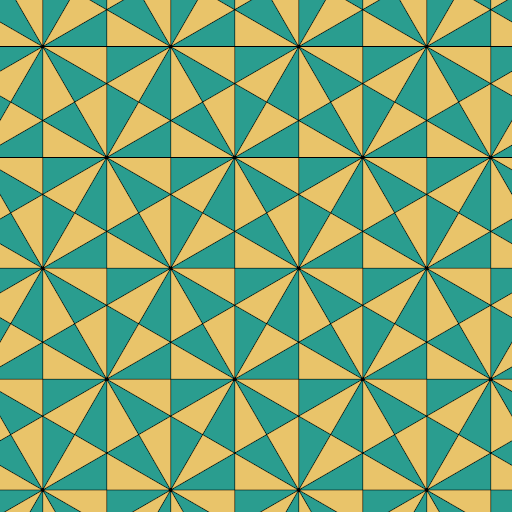
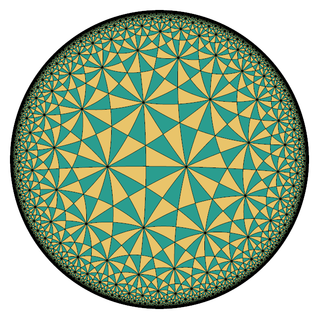
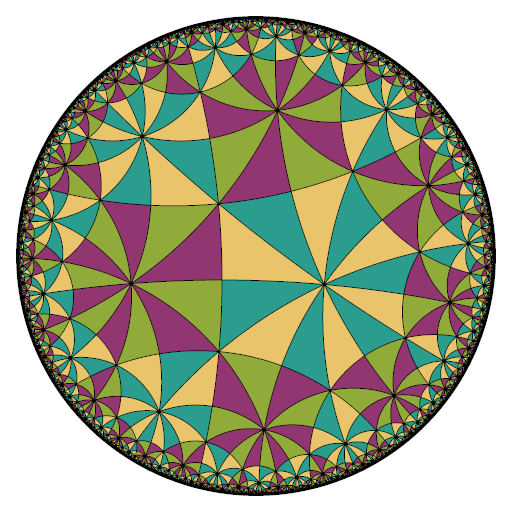
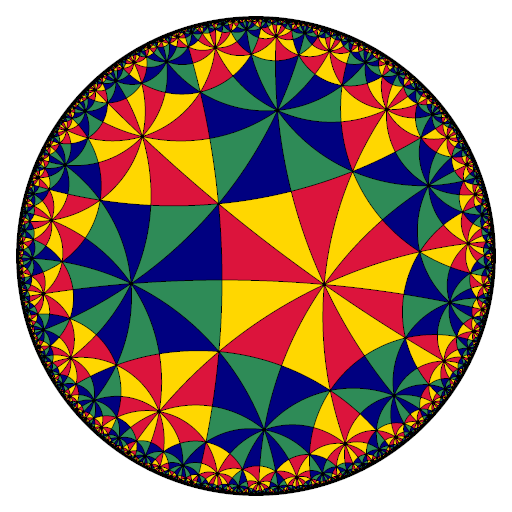
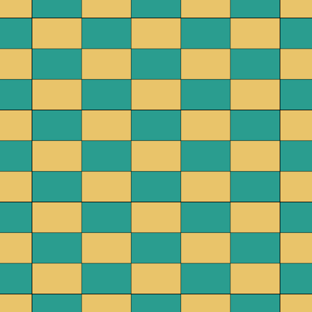
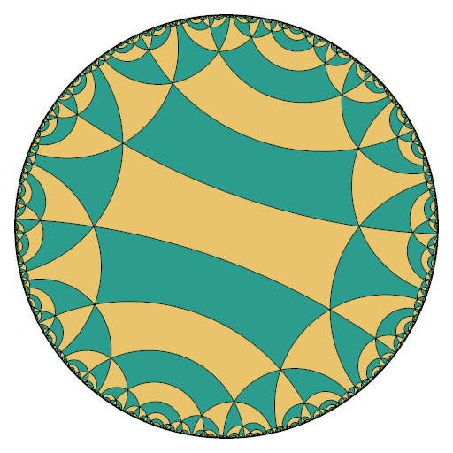
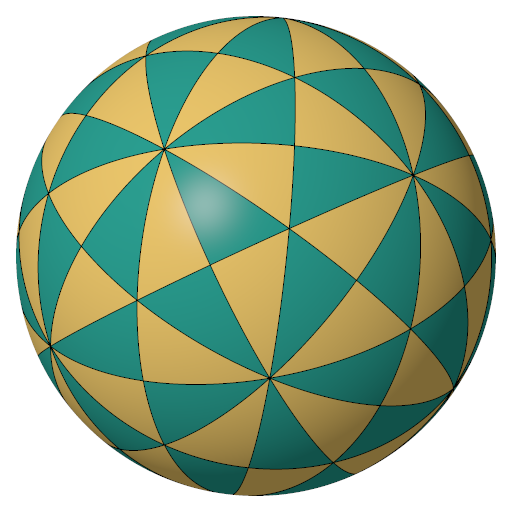

# Escher

[](https://github.com/g-whiz/escher/actions/workflows/ci.yml)

Escher is a command-line tool that renders symmetric tilings, like those in some works of M. C. Escher, into PNG images. You name a symmetry in Conway's orbifold notation, such as `*632`, and Escher draws its tiling in the Euclidean plane, on a shaded ball for a spherical symmetry, or in the Poincare disk for a hyperbolic one. It also counts and lists the colourings of a tiling that respect its symmetry and give neighbouring tiles different colours, and draws any of them in colours that you choose.

## Status

> [!WARNING]
> Escher is a proof of concept. No crate or binary is published, and the commands, options, and output can change in any commit. The graphical application that the project aims for does not exist yet.

## Crates

The workspace holds the command-line tool, five libraries, and a test support crate. Every crate uses this README.

| Crate | Use it to |
| --- | --- |
| [escher-cli](https://github.com/g-whiz/escher/tree/main/crates/escher-cli) | Run the command-line tool `escher`, with its commands `info` and `render`. |
| [escher-render](https://github.com/g-whiz/escher/tree/main/crates/escher-render) | Render the tiling of a fundamental domain into an image and encode it as a PNG file. |
| [escher-domain](https://github.com/g-whiz/escher/tree/main/crates/escher-domain) | Build and verify the fundamental domain of a signature and the side pairings of its group. |
| [escher-group](https://github.com/g-whiz/escher/tree/main/crates/escher-group) | Work with group presentations, run coset enumeration, and search for the colourings of a tiling. |
| [escher-signature](https://github.com/g-whiz/escher/tree/main/crates/escher-signature) | Parse an orbifold signature into its canonical form and classify it as spherical, Euclidean, or hyperbolic. |
| [escher-geometry](https://github.com/g-whiz/escher/tree/main/crates/escher-geometry) | Compute distances and isometries in the hyperbolic plane, in the Euclidean plane, and on the sphere. |
| [escher-reference](https://github.com/g-whiz/escher/tree/main/crates/escher-reference) | Compute high-precision reference values for this project's own accuracy tests only. |

## Requirements

Building needs Rust 1.99 or later. The first build needs network access, because Cargo downloads the dependencies from crates.io.

Escher supports Linux only. Rendering runs on the CPU and needs no GPU or display.

## Getting Started

From the root of a clone, build the tool and print its help:

```sh
cargo build --release -p escher-cli
./target/release/escher --help
```

The help shows the two commands:

```text
Command-line program of Escher, a tool for symmetry-based graphics.

Usage: escher <COMMAND>

Commands:
  info    Print the canonical form, the geometry, and other properties of a signature in orbifold notation
  render  Render the tiling of a signature in orbifold notation and write it to a PNG file

Options:
  -h, --help     Print help
  -V, --version  Print version
```

The commands below call the tool `escher`. Add `target/release` of the clone to your `PATH`, or write `./target/release/escher` instead.

This command writes the tiling of `*632` to `tiling.png`, 512 by 512 pixels, and replaces the file if it exists. A POSIX shell treats `*`, `(`, and `)` as special characters, so put a signature that contains any of them in single quotes:

```sh
escher render '*632' -o tiling.png
```



## Examples

Run each command in the directory where you want the images.

`escher info` prints the properties of a signature. This command inspects `*632`:

```sh
escher info '*632'
```

It prints the geometry, the shape of the fundamental domain, and how many colourings the tiling has for each number of colours up to 12:

```text
Signature: *632
Geometry: Euclidean
Euler characteristic: 0
Compact: yes
Domain: 3 mirror sides
Corner angles in degrees: 30.000000, 60.000000, 90.000000
Side lengths: 1.000000, 1.154701, 0.577350
Domain area: 0.288675
Colourings: 39, complete to 12 colours
Colourings with 2 colours: 1
Colourings with 3 colours: 1
Colourings with 4 colours: 1
Colourings with 6 colours: 10
Colourings with 8 colours: 3
Colourings with 9 colours: 3
Colourings with 12 colours: 20
```

A hyperbolic signature renders in the Poincare disk. This command draws `*732` at 640 by 640 pixels:

```sh
escher render '*732' --size 640x640 -o disk.png
```



`--colourings` lists each colouring with its id, and `--max-colours` sets the largest number of colours, from 1 to 64. This command lists the colourings of `*642` with up to 4 colours:

```sh
escher info --colourings --max-colours 4 '*642'
```

After the properties and the counts, it prints one line for each colouring:

```text
Colouring: 2a, 2 colours, alias parity
Colouring: 4a, 4 colours
Colouring: 4b, 4 colours
Colouring: 4c, 4 colours
Colouring: 4d, 4 colours
Colouring: 4e, 4 colours
Colouring: 4f, 4 colours
Colouring: 4g, 4 colours
```

`--colouring` takes an id from this list, or `one` or `parity`. This command draws the colouring `4a` in the first four colours of a built-in list of 12:

```sh
escher render '*642' --colouring 4a -o four.png
```



`--colours` gives one colour for each colour of the colouring, as `#rgb` or `#rrggbb`. A colouring with more than 12 colours needs it. This command draws the same colouring in crimson, gold, navy, and sea green:

```sh
escher render '*642' --colouring 4a --colours '#dc143c,#ffd700,#000080,#2e8b57' -o four-colours.png
```



`escher info` prints one `Parameter` line for each shape parameter of a signature. For `*2222`, the line is:

```text
Parameter: aspect, range 0.125 to 8, default 1
```

`--set` sets a shape parameter as `NAME=VALUE`. This command draws `*2222` with rectangles whose sides are in the ratio 1.618:

```sh
escher render '*2222' --set aspect=1.618 -o rectangles.png
```



A hyperbolic reflection polygon has one length parameter for each corner beyond three. This command lengthens the one slice of `*3333` from its default of 1.317, which changes the shape of each tile:

```sh
escher render '*3333' --set slice1.length=2.5 -o polygon.png
```



A spherical signature renders as a ball with Phong shading. `--rotation` turns the ball by three angles in degrees, `YAW,PITCH,ROLL`. This command turns the ball of `*532` 20 degrees to the right and 35 degrees up:

```sh
escher render '*532' --rotation 20,35,0 -o ball.png
```



`escher render --help` lists the other options, which set the border width and colour, the background, the samples in each pixel, the number of threads, and the light and shading of the ball.

## Supported Signatures

`escher info` reports on any valid signature. `escher render` draws a signature only when Escher builds its fundamental domain, which the `Domain` line of `escher info` shows. This table lists the signatures with a fundamental domain:

| Geometry | Supported | Not supported yet |
| --- | --- | --- |
| Euclidean | All 17 wallpaper groups, such as `*632`, `o`, and `22x` | Friezes, which have an infinite order, such as `*22(inf)` |
| Spherical | Every spherical signature, such as `*532`, `3*2`, `5x`, and `1`, with orders up to 100, and up to 50 for `2*n` | Orders above these limits |
| Hyperbolic | Compact reflection triangles `*pqr` and their rotation signatures `pqr`, such as `*732` and `732`, and compact reflection polygons `*p1...pn` with 4 to 8 corners and their rotation signatures `p1...pn`, such as `*3333` and `3333`, with orders up to 100 | Every other hyperbolic signature, such as `3*4`, signatures with an infinite order, and signatures with more than 8 orders |

These signatures take shape parameters through `--set`:

- `o` and `2222` take `aspect` and `skew`.
- `*2222`, `**`, `xx`, `*x`, `22*`, `22x`, and `2*22` take `aspect`.
- A reflection polygon `*p1...pn` takes one length for each corner beyond three. Its rotation signature takes none.

Escher refuses a few rotation signatures of polygons with 8 orders, several of them high, because it cannot build their domains accurately.

## Documentation

The [command-line design](https://github.com/g-whiz/escher/blob/main/docs/design/cli.md) describes every command, option, output line, and exit status of `escher`. The [design documents](https://github.com/g-whiz/escher/tree/main/docs/design) describe each crate, the architecture, the plan, and the roadmap. The [research documents](https://github.com/g-whiz/escher/tree/main/docs/research) hold the mathematics behind the code, with its sources. Contributors read [AGENTS.md](https://github.com/g-whiz/escher/blob/main/AGENTS.md) for the rules of the repository.

## Licence

Escher is licensed under the GNU General Public License, version 3 or later, `GPL-3.0-or-later`. The [LICENSE](https://github.com/g-whiz/escher/blob/main/LICENSE) file holds the text.
